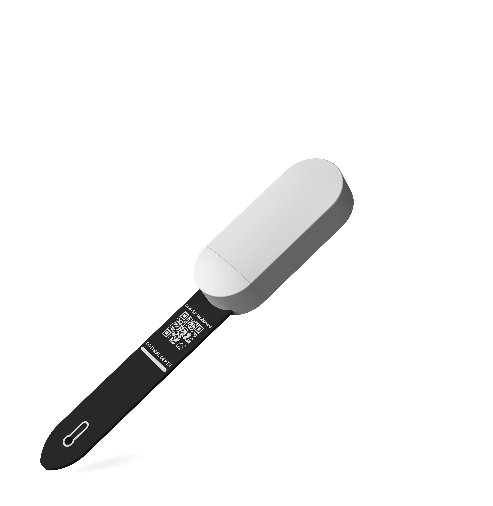
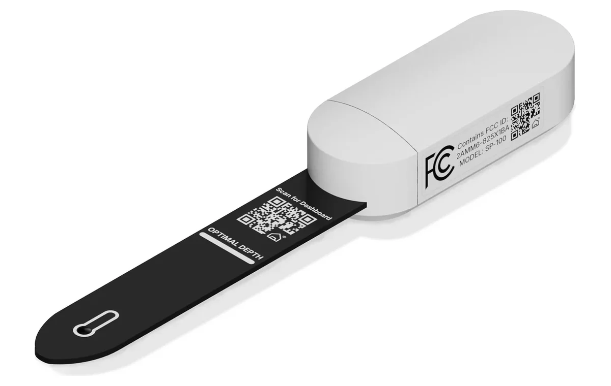
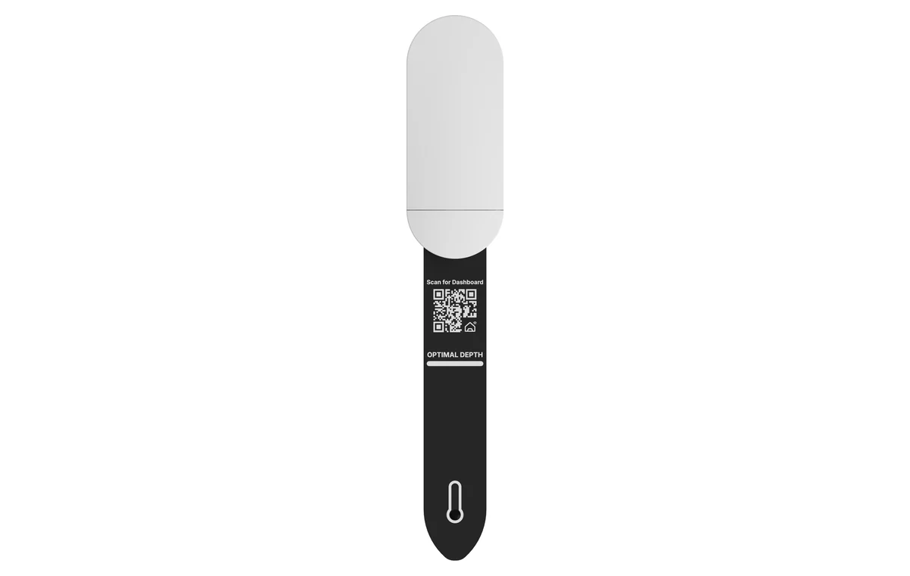
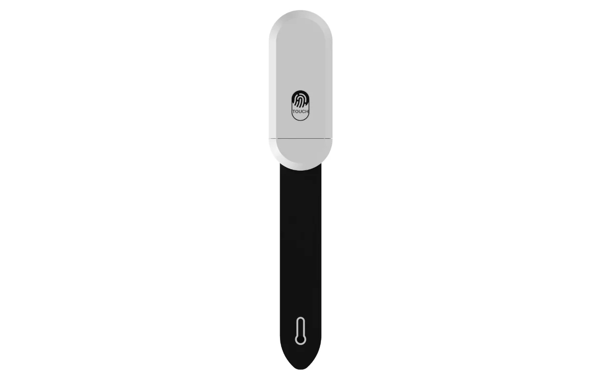
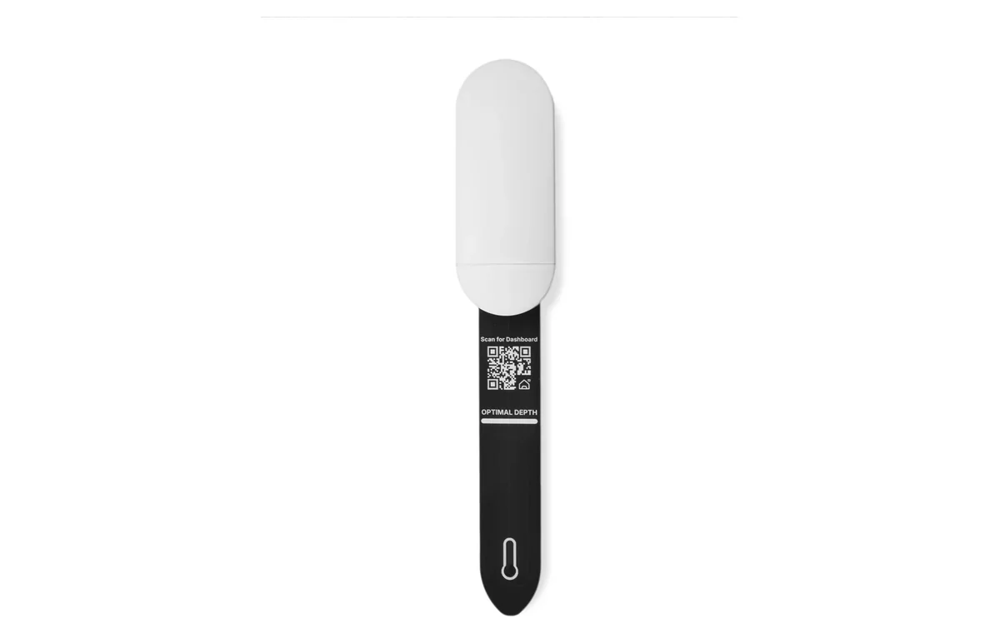
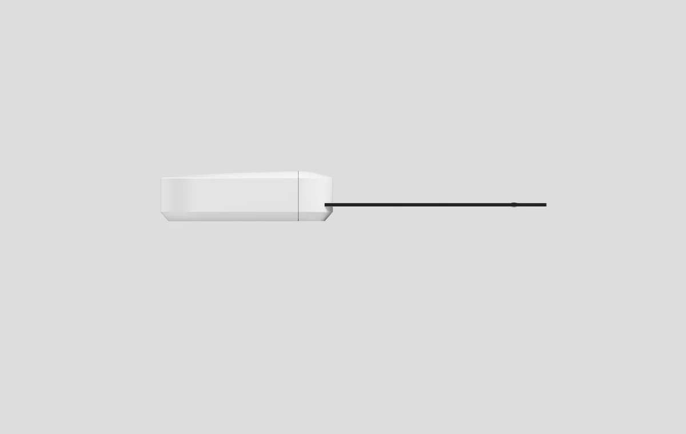
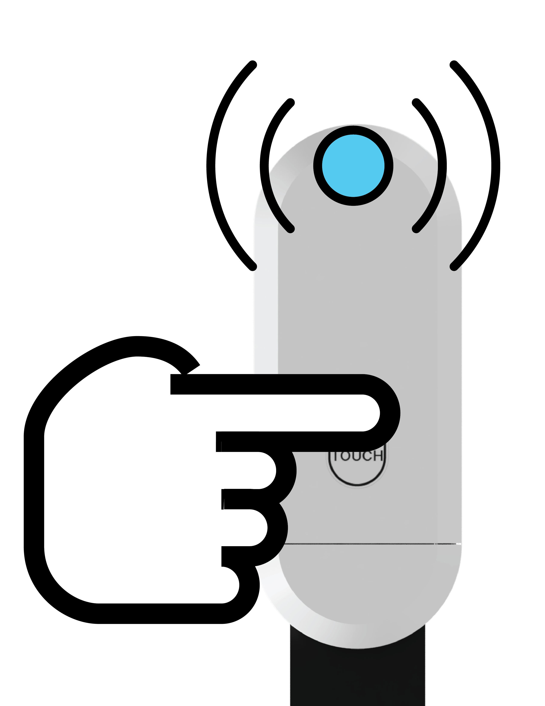
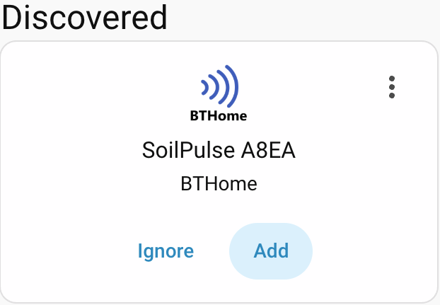

# SoilPulse SP100

SoilPulse SP100 reports soil moisture, soil temperature and battery level over Bluetooth Low Energy. It advertises BTHome v2, so Home Assistant can discover it without a hub. The Web Bluetooth dashboard covers live readings, calibration and history charts.

This repository documents the SP100 interface for Home Assistant and other integration tools. The sensor works locally and needs no cloud account. Firmware and dashboard source are not published here; the protocol described is the one the device uses.



## Specifications

| Item | Value |
| --- | --- |
| Model | SP-100 |
| Power | 2 × AAA alkaline batteries (not included) |
| Battery life | Up to 1–2 years, depending on batteries and use |
| Update interval | About every 10 minutes |
| Water resistance | Weatherproof: safe in rain, during watering and in brief pooling |
| Wireless range | Up to 100 ft in open space |
| Probe depth | To the `OPTIMAL DEPTH` mark, about 2.4 in |
| Operating temperature | −20 to +60 °C (−4 to +140 °F) |
| Connectivity | Web Bluetooth LE |
| Smart home | Home Assistant via BTHome |

## Hardware

The black probe carries the dashboard QR code and the `OPTIMAL DEPTH` line. The grey housing holds the batteries and the touch pad. Insert the probe to the line and keep the housing out of the soil.

| # | Part | Function |
| --- | --- | --- |
| 1 | Touch Pad | Tap to wake Bluetooth |
| 2 | Device QR | Scan with a camera to open the dashboard |
| 3 | Optimal Depth | Insert the probe to this line, about 2.4 in |
| 4 | Temperature Sensor | Root-zone temperature probe |

### Product views

| | |
| --- | --- |
|  |  |
| *Angled: QR code, depth mark, FCC label* | *Front: QR code and OPTIMAL DEPTH mark* |
|  |  |
| *Back: touch pad* | *Upright* |
|  | |
| *Side profile* | |

## BTHome v2 advertisement

The sensor advertises battery, temperature and moisture using the public BTHome v2 format. Home Assistant reads these values directly; no pairing is required.

| Object | Value | Unit |
| --- | --- | --- |
| Battery | Unsigned 8-bit | 1% per step |
| Temperature | Signed 16-bit, little-endian | 0.01 °C per step |
| Moisture | Unsigned 16-bit, little-endian | 0.01% per step |

The 128-bit GATT service UUID is `749b53b7-2662-4658-9fb4-e47241816727`. Byte-level layouts are in [docs/webble-gatt.md](docs/webble-gatt.md).

## Web Bluetooth dashboard

Scan the QR code on the probe or open <https://soilpulse.alinfancy.com> over HTTPS. Web Bluetooth needs a secure context.


| Platform | Browser |
| --- | --- |
| Android, Windows, macOS | Chrome |
| iOS / iPadOS | Safari with the Beacio extension; on older iOS devices, Bluefy |

iOS Safari and iOS Chrome do not expose Web Bluetooth on their own. Install the Beacio extension, or use Bluefy on older devices. Touch the pad to wake the sensor before connecting.




Calibration and history charts live in the dashboard settings. See [docs/calibration.md](docs/calibration.md) and [docs/troubleshooting.md](docs/troubleshooting.md).

## Home Assistant quick start

1. Make sure the host has Bluetooth enabled and is within range.
2. Go to **Settings → Devices & Services → Add Integration** and add **BTHome**.
3. Touch the sensor pad, then wait for `SoilPulse` to appear.
4. Add the temperature, moisture and battery entities.

Packets arrive about every 10 minutes. `unavailable` between updates is normal while the sensor is asleep. Entity IDs in the bundled automations are examples and must be replaced with your own.



## Repository layout

```text
SoilPulse-SP100-public/
├── README.md
├── CONTRIBUTING.md
├── CHANGELOG.md
├── .github/
│   └── ISSUE_TEMPLATE/
├── docs/
│   ├── calibration.md
│   ├── troubleshooting.md
│   └── webble-gatt.md
├── examples/
│   └── home-assistant/
│       ├── low_moisture_alert.yaml
│       ├── auto_irrigation_valve.yaml
│       └── low_battery_alert.yaml
├── assets/
│   └── images/
└── LICENSE
```

## Contributing

This repository covers documentation and integration examples; the firmware and dashboard source are not published here. To report a documentation error or an integration question, open an issue with the matching template. For hardware faults, see Support below. Full details are in [CONTRIBUTING.md](CONTRIBUTING.md).

## Support

Questions or feedback about the device? Email <support@alinfancy.com>.

## License

MIT. See [LICENSE](LICENSE).
