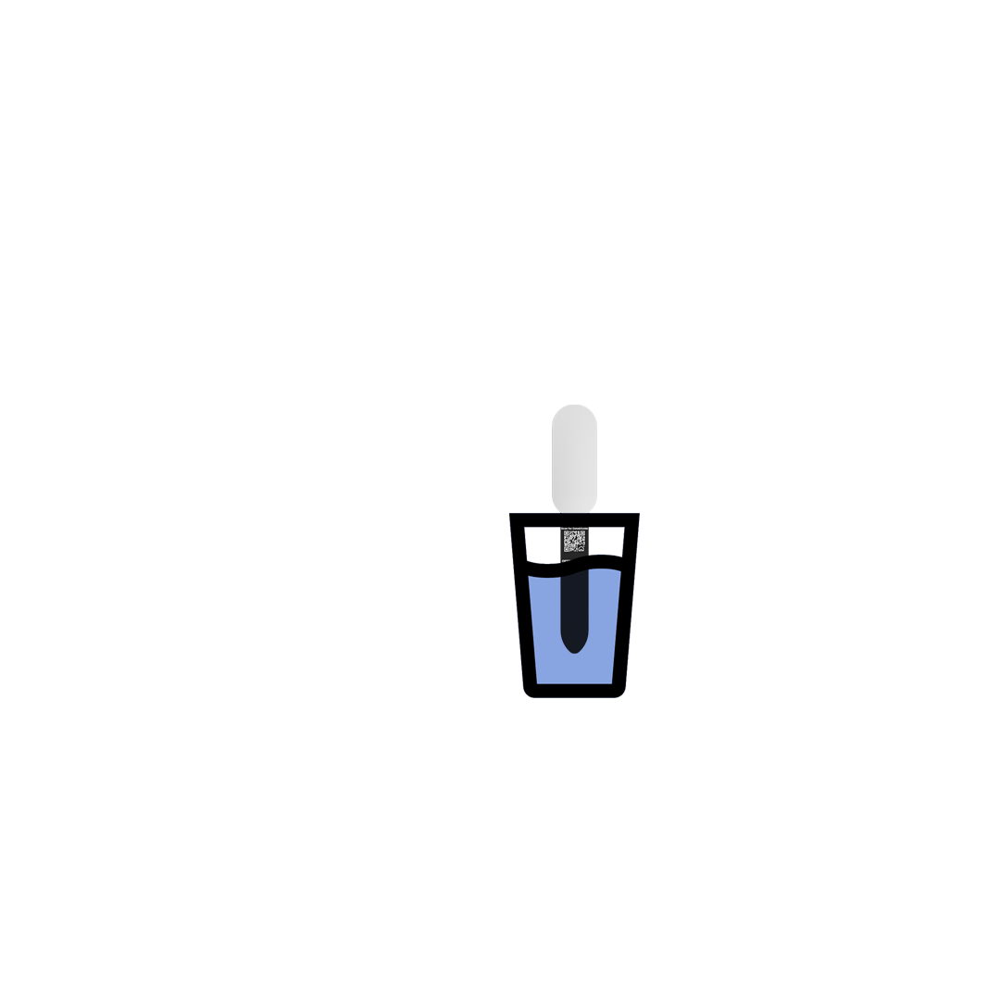

# Calibration

The reported moisture percentage is a relative reading from a capacitive probe. It is not volumetric water content. Two reference points, dry and wet, map the probe reading onto 0% and 100% for the soil around the probe.

## When to calibrate

Calibration is optional. Use it when you want the reading to match a specific soil or substrate rather than the factory baseline. The same two-point procedure works for any substrate; the sensor does not ship with per-substrate reference tables.

## Two-point calibration

1. Put the probe in dry air, away from soil, water and sunlight. Wait until the reading settles. The firmware requires it to be below 20%.
2. In the dashboard, use the **Dry** button, or write `0x00` to characteristic `0xFFE6`.
3. Immerse only the probe up to the `OPTIMAL DEPTH` mark in water. Do not submerge the housing. Wait until the reading is above 80%.
4. Use the **Wet** button, or write `0x01` to `0xFFE6`.
5. Read `0xFFE9`. The first byte is a flag mask (bit 0 dry, bit 1 wet, bit 2 temperature). The second byte is the result code.

The dry and wet anchors must produce clearly different readings. If the two steps are too close together, the write is rejected and you should repeat them with a genuinely dry and a genuinely wet sample.

| Result code | Meaning |
| --- | --- |
| 0 | No calibration attempt |
| 1 | Dry anchor saved |
| 2 | Wet anchor saved |
| 3 | Rejected, reading was not dry enough (≥20%) |
| 4 | Rejected, reading was not wet enough (≤80%) |
| 5 | Rejected, anchors were too close together |
| 6 | Attempt discarded |
| 7 | Rejected, anchor direction was reversed |

Calibration is retained when you replace the batteries or update the firmware. A factory reset clears it.

## Temperature offset

Write a 2-byte little-endian signed integer to `0xFFE8`. One step is 0.01 °C and the accepted range is ±10.00 °C. This offset is added to the reported temperature and is stored with the moisture anchors.

## Substrates

We do not publish reference values for peat, coco coir or ceramsite. Treat any number from a different sensor or substrate as a starting point, not a measured value for this probe.

For a new substrate, saturate a representative sample, let free water drain, take the wet anchor there, then air-dry or oven-dry the same sample for the dry anchor. Record the substrate, its moisture content by weight, temperature, probe depth and battery condition with each anchor so the result can be reproduced.

## Getting a fresh reading

Calibration does not trigger a new measurement by itself. Touch the pad to wake the sensor before connecting. To measure immediately, connect over GATT and write `0x01` to `0xFFE7`, then read `0xFFEB`. The Home Assistant entity updates on the next BTHome packet.

## Reference

Byte-level definitions for every characteristic are in [webble-gatt.md](webble-gatt.md).
